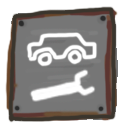

<p align="center"></p>

# Apocars

**Make your own vehicles and car parts for Apocalypter and then export them as standalone mods.**

Apocars has two halves:

- **The mod** (`runtime/`, a BepInEx 5 plugin) builds vehicles and parts from `.glb` models and `.lua` descriptions. It builds them on top of the game's own cars, so they drive, burn fuel, take parts and break like the real thing.
- **The Blender add-on** (`blender/apocars/`) walks you through making one, step by step. It exports the model straight into the game, where the car rebuilds in about a second while you play.

> [!NOTE]
> Apocars is simply a tool, and is still in development. For a proper use Apocasetter and Blender 5.0+ are needed. Contact me in Discord (internet_gremlin) if you want some feature or if something breaks (but using GitHub is a preferred method)

---

## Main features

### In game (the mod)

The mod itself is needed for hot reload and extracting game files for you to use in Blender. Also has a couple of debugging features, but any other mod that spawns items is recommended.

### In Blender (the add-on)

- **A step-by-step panel** in the 3D View sidebar, with one step for each stage: What you're making → Body → Decorative → Attachment points → Collision boxes → Properties → Export. Every option has a tooltip.
- **Test buttons** that preview a real game part on an attachment point, so you can see that an engine, wheel or seat fits before going in game.
- **Decorative:**
  - **Import game material** puts a game material on the selected mesh.
  - **Import game car part** adds the game's suspensions, drivetrains, engine bays and fuel tanks as decoration.
- **Colliders from a mesh** with [CoACD](https://github.com/SarahWeiii/CoACD) convex decomposition. Choose how many pieces (70–120 suits a car body). CoACD runs in the background and installs itself the first time.
- **Driver's view preview.** Look through the driver's eyes with the game's field of view, then exit back to where you were.
- **Lifted suspension.** A slot for the game's lift kit, with a stock and a lifted suspension mesh. The stock mesh shows until the kit is fitted, then the lifted one takes its place. The lifted travel, damping, height and track width are set under Properties → Suspension.
- **Make mesh into attachment.** Turn a selected mesh into a door, hood, bumper or other part, with its own collision and physics-lock sections.
- **Light exports:**
  - game materials carry no pictures, because the game uses its own;
  - your own pictures are saved once in a shared `textures/` folder, however many parts use them.
- **Build mod** makes a standalone mod with its own ID, name and folder. That mod doesn't need Apocars installed. Build mod also makes a `.zip` of it, ready to share.

---

## Quick guide

### 1. Install

1. Install [BepInEx 5](https://github.com/BepInEx/BepInEx/releases) (x64) into the Apocalypter folder and start the game once.
2. **Mod:** from the [Releases](../../releases), extract `Apocars-<version>.zip` into `Apocalypter/BepInEx/plugins`. You should end up with `BepInEx/plugins/Apocars/Apocars.dll`.
3. **Add-on:** in Blender 4.2 or newer, go to **Edit → Preferences → Add-ons → Install from Disk** and pick `Apocars-Blender-addon-<version>.zip`. The panel is in the 3D View sidebar: press **N**, then open the **Apocars** tab.

### 2. Get the game's parts into Blender (once)

The Test buttons, game mounts, game materials and decorations come from your copy of the game.

1. Start the game and load a save.
2. In `BepInEx/config/com.apocalypter.apocars.cfg`, set `Tools.DumpVanilla = true`, or switch it on in Apocasetter. Apocars writes the game's vehicles and parts to `BepInEx/Apocars-vanilla` and switches the option back off.
3. In Blender, under **Export**, click **Build vanilla library**. It takes a minute or two.

### 3. Make a car

1. **What you're making:** choose **Vehicle**, then give it an ID (letters, digits and `_`), a name and a mod folder. Check that the game folder was found.
2. **Body:** select your car's mesh, click **Use selected** (the eyedropper), then **Set up**.
3. **Attachment points:** press **+** on a row to add a point (an engine, a wheel, a door...) and move it into place. **Test** previews a game part on it. For your own doors, hood and so on, select the mesh and use **Make mesh into attachment**.
4. **Collision boxes:**
   - Add the **Driver's seat** and set its view and exit spots. **Preview** shows the driver's view.
   - Adding a switch panel adds the ignition and headlight boxes on its own.
   - Under **Solid**, use **Add box** for simple shapes, or select a mesh and split it into convex pieces.
5. **Properties:** choose where it spawns, and set up suspension, differentials and the fuel tank size.
6. **Export:**
   - **Hot export** writes the car into the game. If the game is running, the car appears or rebuilds within a second.
   - To spawn one in front of you, set `Tools.Spawn` in the config to your car's ID.
   - **Build mod** makes a standalone mod and a zip to share. 
   **YOU  DO NOT NEED TO LIST THIS MOD AS A DEPENDENCY. THAT IS THE WHOLE POINT. BUILDING VEHICLES INTO A STANDALONE MOD IS THE INTENDED WAY FOR YOU TO SHARE VEHICLES**

Parts are made the same way: choose **Attachment** in the first step.

---

## Building from source

You need the [.NET SDK](https://dotnet.microsoft.com/download) and an Apocalypter install with BepInEx, whose DLLs the mod is built against.

```sh
python3 scripts/make_release.py "<path to Apocalypter>"
```

The script writes both archives into `dist/`. To build just the mod:

```sh
cd runtime
dotnet build -c Release -p:GameDir="<path to Apocalypter>"
```

### Layout

| Folder | What's in it |
|---|---|
| `runtime/` | The BepInEx plugin (C#). `Assembler.cs` builds a vehicle from a spec, `Parts.cs` builds parts, `Gltf.cs` loads models, `Spawning.cs` handles spawn lists, `Hinges.cs` hangs doors and lids, and `Rebuild.cs` does the hot reload. |
| `blender/apocars/` | The Blender add-on (Python). `ui.py` is the panel, `export.py` writes `.glb` and `.lua`, `build.py` makes standalone mods, `colliders.py` does the CoACD split, and `glbpack.py` keeps exports light. |
| `tools/` | Development scripts: build the add-on's game data from a vanilla dump, read PlayMaker FSMs, build the vanilla library, and make a test car. |
| `scripts/` | `make_release.py` builds both archives. |

### How a vehicle is described

The add-on writes an `<id>.lua` next to `<id>.glb`. The `.lua` returns a table with:

- the model;
- which game vehicle to build on;
- the attachment points (objects in the model, by name);
- boxes, solids, wheels and their suspension;
- differentials, fuel and spawn lists.

Apocars reads every `.lua` in `BepInEx/plugins/<any mod>/apocars/`.

---

## Credits

- [MoonSharp](https://www.moonsharp.org/) (MIT) reads the `.lua` files.
- [CoACD](https://github.com/SarahWeiii/CoACD) (MIT) does the convex decomposition. It's installed by the add-on, not bundled.
- [UnityPy](https://github.com/K0lb3/UnityPy) (MIT) reads the game's files for the vanilla library. It's installed by the add-on, not bundled.

## License

[MIT](LICENSE)
